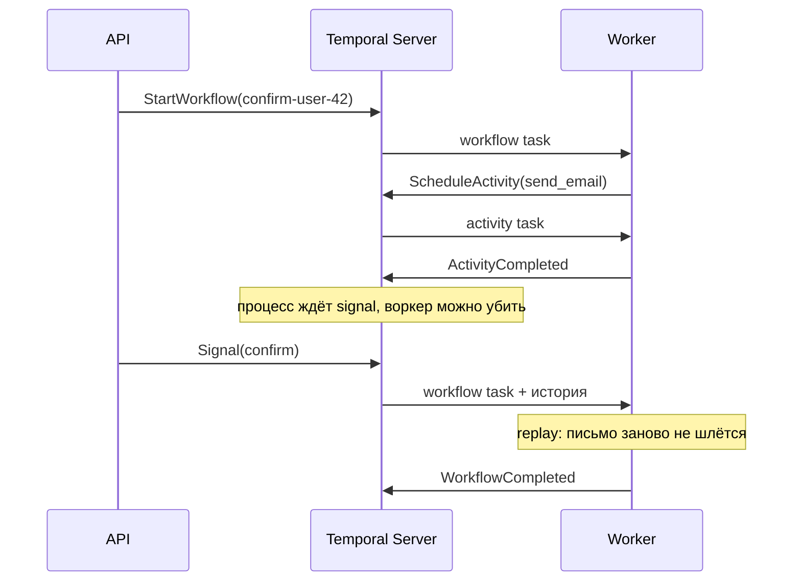

# Temporal — долгие процессы, которые переживают рестарт

# TO-DO: прогнать Python-пример локально (`temporalio/auto-setup` + воркер ниже)

> **Temporal** ([temporal.io](https://temporal.io)) помнит, на каком шаге остановился долгий процесс, и продолжает его после падения процесса, деплоя или ожидания в несколько дней.

Обычный код живёт в памяти процесса. Процесс умер — пропали и переменные, и место в сценарии. Temporal выносит это место на свой сервер и хранит журнал: что уже сделали, чего ждём, когда проснуться.

Вырос из Uber Cadence. Есть **Temporal Server** (или Temporal Cloud), **SDK** (Go, Java, TypeScript, Python, .NET) и **воркеры** — ваши процессы, которые исполняют код.

См. также: [distributed_transactions.md](distributed_transactions.md) (Saga), [celery.md](celery.md), [brokers.md](brokers.md), [kafka.md](kafka.md).

---

## Зачем он нужен

Типичная задача: оформить заказ.

1. Зарезервировать товар.
2. Списать деньги.
3. Подождать 3 дня — вдруг клиент вернёт.
4. Отправить письмо «спасибо».

`sleep(3 дня)` внутри сервиса здесь не помогает: процесс убьют при деплое, и никто не вспомнит, что деньги уже списаны, а письмо ещё нет. Таблица статусов и cron это закрывают, пока сценариев мало. Дальше появляются двойные списания, пропущенный шаг и ночные разборы «cron сработал дважды».

Temporal забирает журнал шагов, таймеры и повтор упавших шагов. Сценарий остаётся обычным кодом: сделай A, сделай B, подожди, сделай C.

| Подход | Что получается |
| --- | --- |
| Celery | Одна задача: выполнил и забыл. Связи «пять шагов одного заказа» нет |
| Kafka | Доставляет события между сервисами. Порядок шагов пишете вы |
| Airflow | Пакетная обработка данных по расписанию |
| Таблица `status` + cron | Тот же журнал и те же ретраи, только самописные |
| Temporal | Один процесс на заказ: шаги, паузы, внешние события, одна история с id `order-123` |

---

## Кто с кем говорит

Три роли:

```text
1) Ваш API     — «начни процесс для заказа 123»
2) Temporal    — журнал и таймеры. В банк и в базу сам не ходит
3) Worker      — ваш Python/Go: опрашивает сервер и делает HTTP, SQL, почту
```

Сервер и воркер связаны через **task queue** — именованную очередь, например `orders`. API кладёт работу в `orders`, воркер слушает `orders`. Разные команды могут слушать разные очереди.

```text
┌─────────────┐     gRPC       ┌──────────────────┐
│  Ваш API    │──────────────▶ │ Temporal Server  │
│  (starter)  │  StartWorkflow │  журнал, таймеры │
└─────────────┘                └────────┬─────────┘
                                        │ poll
                               ┌────────▼─────────┐
                               │  Worker          │
                               │  ваш код         │
                               └────────┬─────────┘
                                        │
                               ┌────────▼─────────┐
                               │  PostgreSQL,     │
                               │  Stripe, SMTP    │
                               └──────────────────┘
```

Воркер между рестартами состояние не хранит. Источник правды — журнал на сервере. У self-hosted журнал лежит в PostgreSQL (в старых деплоях встречалась Cassandra). Temporal Cloud — тот же сервер, только управляемый.

Один клик «оформить заказ» создаёт одну запись-процесс. Воркер может жить на любой машине: журнал общий.

---

## Термины

### Workflow — сценарий

Функция, которая решает порядок шагов: сначала резерв, потом оплата, потом пауза, потом письмо. Сама в банк не ходит и в базу не пишет.

В коде это класс с методом `run`. Внутри — `if`, циклы, параллельные ветки, таймеры, ожидание сигналов, запуск дочерних workflow.

Жёсткое правило — **детерминизм**. Почему оно такое, разобрано в разделе про replay ниже. Коротко: при одном и том же журнале код должен принимать те же решения.

| В workflow можно | В workflow нельзя |
| --- | --- |
| Ветвления по результату activity | `requests`, SQL, запись в файл |
| `workflow.now()` — время из журнала | `datetime.now()`, `time.time()` |
| `workflow.uuid4()` | `random.random()` |
| Вызов activity, child workflow, таймера | Глобальные переменные с побочным эффектом |

Побочные эффекты живут в activities.

### Activity — один ненадёжный шаг

Сходить в Stripe, записать строку, отправить письмо. Сеть падает, сервис отвечает 500 — Temporal вызывает activity снова по **retry policy**, пока не запишет в журнал «успех» или не исчерпает попытки.

У activity есть таймауты:

- **start-to-close** — сколько может длиться одна попытка;
- **schedule-to-close** — сколько всего можно ждать, включая очередь и ретраи;
- **heartbeat** — для долгого шага воркер периодически сообщает «я жив». Если heartbeat пропал, попытку можно отдать другому воркеру.

Успешный шаг при replay заново не выполняется: в журнале уже лежит результат. До записи успеха activity могут вызвать несколько раз, поэтому шаг должен быть **идемпотентным**: один и тот же `order_id` не списывает деньги дважды (`Idempotency-Key`, `INSERT … ON CONFLICT`).

### Worker — процесс с вашим кодом

Долгоживущий процесс. Регистрирует типы workflow и activities и опрашивает task queue. Воркеров может быть много: упал один — задачу подхватит другой, потому что журнал на сервере.

Один процесс может исполнять и workflow, и activities. Нагрузку иногда разносят по разным очередям: лёгкая оркестрация отдельно, тяжёлые activities отдельно.

Рядом с воркером есть **client / starter** — кусок вашего API или CLI, который вызывает `start_workflow`. Сам сценарий он не исполняет.

### Signal — сообщение в уже идущий процесс

Асинхронное событие снаружи: «клиент нажал „оплатил“», «менеджер отменил». Отправили и пошли дальше. Workflow может стоять на `wait_condition`, пока сигнал не придёт. Сигнал попадает в тот же журнал.

Рядом два похожих механизма:

| Механизм | Что делает |
| --- | --- |
| **Signal** | Асинхронно передать событие. Ответа нет |
| **Query** | Синхронно спросить «на каком ты шаге?», ничего не меняя. Для UI |
| **Update** | Синхронно попросить что-то сделать и дождаться результата. Новее signal |

### Timer — сон, который не живёт в памяти воркера

`workflow.sleep(3 дня)` — будильник в базе Temporal. В эти три дня воркер может вообще не работать. Когда время придёт, сервер отдаст задачу любому живому воркеру на той же очереди.

### Schedule — cron на стороне сервера

Отдельная сущность: «каждый час создай новый запуск workflow `Reconcile`». Будильник привязан к кластеру, а не к одной виртуалке. Расписание можно поставить на паузу. **Overlap policy** решает, что делать, если прошлый запуск ещё не закончился: пропустить, поставить в очередь, отменить предыдущий, разрешить параллельно.

### Имена, которые путают

| Термин | Смысл |
| --- | --- |
| **Workflow ID** | Бизнес-ключ, например `order-123`. Один заказ — один процесс |
| **Run ID** | Конкретный прогон. При Continue-As-New id процесса тот же, run другой |
| **Workflow type** | Имя класса, `ConfirmEmail` |
| **Event history** | Журнал: старт, activity запланирована, activity завершена, таймер, сигнал |
| **Namespace** | Изоляция окружений внутри кластера: `dev`, `prod` |
| **Task queue** | Имя очереди, по которому стартер и воркер находят друг друга |

Политика конфликта workflow id решает повторный старт с тем же ключом: упасть, вернуть уже идущий процесс или разрешить дубль. Для «один заказ — один процесс» обычно берут отказ или «верни существующий».

---

## Минимальный пример

Сценарий: отправить письмо «подтверди адрес» и ждать, пока человек нажмёт кнопку. Кнопка приходит как signal.

Python SDK: `pip install temporalio`. Код упрощён, но имена API настоящие.

**Сценарий.** Workflow ждёт подтверждения. Activity только печатает письмо — в жизни здесь был бы SMTP.

```python
from datetime import timedelta

from temporalio import activity, workflow


@activity.defn
async def send_email(address: str) -> None:
    print(f"письмо на {address}: подтверди адрес")


@workflow.defn
class ConfirmEmail:
    def __init__(self) -> None:
        self.confirmed = False

    @workflow.signal
    def confirm(self) -> None:
        self.confirmed = True

    @workflow.run
    async def run(self, address: str) -> str:
        await workflow.execute_activity(
            send_email,
            address,
            start_to_close_timeout=timedelta(seconds=10),
        )
        await workflow.wait_condition(lambda: self.confirmed)
        return "подтверждено"
```

`execute_activity` — поручи этот шаг воркеру и дождись результата. `wait_condition` — стой, пока `confirmed` не станет `True`. Пока человек не нажал кнопку, процесс висит в журнале. Память воркера для этого не нужна.

**Worker** — процесс, который этот код исполняет:

```python
import asyncio

from temporalio.client import Client
from temporalio.worker import Worker


async def main() -> None:
    client = await Client.connect("localhost:7233")
    worker = Worker(
        client,
        task_queue="email",
        workflows=[ConfirmEmail],
        activities=[send_email],
    )
    await worker.run()


asyncio.run(main())
```

**Старт и сигнал** — другой процесс, ваш API:

```python
import asyncio

from temporalio.client import Client


async def main() -> None:
    client = await Client.connect("localhost:7233")

    handle = await client.start_workflow(
        ConfirmEmail.run,
        "user@example.com",
        id="confirm-user-42",
        task_queue="email",
    )

    # позже, когда пользователь нажал кнопку
    await handle.signal(ConfirmEmail.confirm)

    result = await handle.result()  # "подтверждено"
    print(result)


asyncio.run(main())
```

`id="confirm-user-42"` — workflow id. Повторный старт с тем же id не создаст второй процесс, пока первый ещё идёт.

**Schedule** — раз в час запускать другой workflow, например сверку платежей. Это не код внутри workflow, а отдельная запись на сервере. `id` здесь не задаём: каждый тик получает свой запуск. Фиксированный id нужен, когда второй запуск при живом первом должен упереться в конфликт.

`Reconcile` — отдельный workflow, его тоже нужно отдать воркеру в списке `workflows`.

```python
import asyncio
from datetime import timedelta

from temporalio import workflow
from temporalio.client import (
    Client,
    Schedule,
    ScheduleActionStartWorkflow,
    ScheduleIntervalSpec,
    ScheduleSpec,
)


@workflow.defn
class Reconcile:
    @workflow.run
    async def run(self) -> str:
        return "сверено"


async def main() -> None:
    client = await Client.connect("localhost:7233")

    await client.create_schedule(
        "reconcile-hourly",
        Schedule(
            action=ScheduleActionStartWorkflow(
                Reconcile.run,
                task_queue="email",
            ),
            spec=ScheduleSpec(
                intervals=[ScheduleIntervalSpec(every=timedelta(hours=1))],
            ),
        ),
    )


asyncio.run(main())
```

Локально сервер поднимается так. Web UI dev-сборки — порт **8233**.

```bash
docker run --rm -p 7233:7233 -p 8233:8233 \
  temporalio/temporal:latest \
  server start-dev --ip 0.0.0.0 --ui-ip 0.0.0.0
```

Сценарий выше учебный: письмо, сага и сверка устроены одинаково. Файлы поэтому называют по роли, а не `confirm_email.py`. Каталог для прогона: `backend/examples/temporal/`.

| Файл | Что внутри |
| --- | --- |
| `workflows.py` | `ConfirmEmail`, потом `OrderSaga` |
| `activities.py` | `send_email` и остальные шаги |
| `worker.py` | процесс, который слушает очередь `email` |
| `starter.py` | `start_workflow`, сигнал `confirm`, ожидание результата |
| `schedule.py` | `create_schedule` для `Reconcile` |

Workflow id в коде — бизнес-ключ, `confirm-user-42`, а не имя файла.

---

## Если воркер умер

Журнал одного запуска выглядит так:

```text
WorkflowExecutionStarted
ActivityTaskScheduled      (send_email)
ActivityTaskCompleted
WorkflowExecutionSignaled  (confirm)     # когда пользователь нажал кнопку
WorkflowExecutionCompleted
```

Пока сигнала нет, последняя запись — завершённая activity, и процесс ждёт.

Что происходит по шагам:

1. API стартовал `confirm-user-42`. Воркер отправил письмо. В журнал записано: activity завершена.
2. Процесс стоит на `wait_condition`. Воркер убили деплоем.
3. Поднялся новый воркер. Сервер отдал журнал. Код `run` выполнился с начала, но `send_email` в журнале уже успешна — письмо второй раз не уходит.
4. Снова встаёт на ожидание сигнала.
5. Приходит `confirm`. Воркер дописывает в журнал «сигнал получен», `confirmed` становится `True`, workflow завершается.

Это и есть **replay**: повторный прогон кода по дневнику. SDK подставляет уже записанные результаты и выполняет только новый хвост — один ещё не записанный шаг.



Поэтому `datetime.now()` и HTTP внутри workflow ломают модель. При replay код проходит тот же путь ещё раз. Время «сейчас» будет другим, а HTTP ушёл бы во внешний мир повторно. Время берут через `workflow.now()`, случайный id — через `workflow.uuid4()`, сеть и базу — только из activity.

Отличие от «сохранить объект в Redis»: произвольный объект вы не сериализуете. Состояние восстанавливается детерминированным кодом плюс журналом. По духу это event sourcing для одного процесса, с уже готовым слоем оркестрации.

**Continue-As-New.** У журнала есть потолок, порядка десятков тысяч событий. Бесконечный процесс (раз в минуту что-то проверять годами) завершает текущий run и стартует новый с тем же workflow id, передавая сжатое состояние во входные аргументы. Бизнес-ключ тот же, run id новый, история короткая.

---

## Saga: откатить то, что уже успели сделать

В [distributed_transactions.md](distributed_transactions.md) Saga — цепочка локальных шагов и компенсирующие действия, если дальше не получилось. В Temporal это один workflow:

```python
@workflow.defn
class OrderSaga:
    @workflow.run
    async def run(self, order_id: str) -> None:
        reserved = False
        charged = False
        try:
            await workflow.execute_activity(
                reserve,
                order_id,
                start_to_close_timeout=timedelta(seconds=30),
            )
            reserved = True
            await workflow.execute_activity(
                charge,
                order_id,
                start_to_close_timeout=timedelta(seconds=30),
            )
            charged = True
        except Exception:
            if charged:
                await workflow.execute_activity(
                    refund,
                    order_id,
                    start_to_close_timeout=timedelta(seconds=30),
                )
            if reserved:
                await workflow.execute_activity(
                    release_stock,
                    order_id,
                    start_to_close_timeout=timedelta(seconds=30),
                )
            raise
```

Состояние «на каком шаге» лежит в журнале. Ретраи и таймауты задаются у activity. Компенсации проектируете вы: Temporal сам SQL не откатывает.

Тот же бизнес-процесс можно собрать хореографией в Kafka: сервисы шлют друг другу события без центрального сценария. Temporal — центральный оркестратор в коде. Оба стиля живут рядом. Короткий `resize_image` по-прежнему уместен в Celery.

---

## С чем сравнивать

| | Celery | Airflow | Temporal |
| --- | --- | --- | --- |
| Единица | Одна task | DAG на дату/партицию данных | Workflow: много activities, таймеры, сигналы |
| Память между шагами | Ваша БД или Redis | Метаданные DAG-рана | Журнал на сервере |
| Долгая пауза | Cron плюс свой статус | Расписание батчей | Durable timer |
| Повтор при сбое | Задачу могут выполнить дважды | Повтор task дага | Успешная activity при replay берётся из журнала |
| Когда брать | Короткий фон | Data pipelines | Заказ, онбординг, согласование на дни |

Celery и Temporal спокойно стоят в одном продукте. Airflow думает «какой кусок данных обработать». Temporal думает «как довести один заказ до конца».

---

## Надёжность

| Что | Как ведёт себя |
| --- | --- |
| Workflow task | Могут доставить больше одного раза. Повтор безопасен за счёт replay |
| Activity | Попыток может быть несколько, пока успех не записан в журнал. Дальше результат читается из истории |
| Таймер | Лежит в persistence и срабатывает после рестарта кластера |
| Exactly-once на весь бизнес-эффект | Сквозной гарантии нет. Успешная activity повторно не исполняется, а внешний API всё равно проектируют идемпотентным |

В инциденте смотрят последнее событие в журнале: зависли на activity, на таймере или на сигнале. Поиск по типу, статусу и своим полям — visibility / search attributes. Метрики и трейсы — Prometheus и OpenTelemetry.

---

## Когда код workflow уже в проде, а его надо менять

В проде тысячи старых запусков ещё идут. Поменяли порядок шагов — replay старого журнала новым кодом расходится с историей, workflow встаёт с **non-deterministic error**.

Что с этим делают:

1. **Worker versioning.** Деплой помечается `build_id`. Старые запуски маршрутизируются на старый код, новые — на новый.
2. `workflow.patched` / `get_version` — ветка «если эта версия ещё не в журнале, иди старым путём».
3. Activities менять проще: воркер вызывает их по имени, старый workflow просто попадает в новый код шага. Сам шаг по-прежнему должен оставаться идемпотентным.

---

## Когда Temporal уместен

Хорошо ложится на:

- процессы с ожиданием в часы и дни: эскалации, напоминания, период возврата;
- saga между сервисами;
- human-in-the-loop: сигнал «менеджер одобрил»;
- дорогую ошибку «шаг выполнили дважды или пропустили».

Слабее как первый выбор:

- одна короткая задача без состояния между шагами — Celery или RQ;
- чистый обмен событиями без центрального сценария — Kafka;
- команда не готова сопровождать кластер (есть Temporal Cloud);
- ответ нужен внутри одного синхронного HTTP-запроса. Старт workflow быстрый, сам сценарий по природе асинхронный.

---

## Ошибки, на которых спотыкаются

1. HTTP или SQL внутри workflow. Replay либо сломается, либо повторит побочный эффект.
2. `datetime.now()` в workflow. При перемотке время другое. Нужен `workflow.now()`.
3. Толстый payload в журнале. В историю кладут id, файл лежит в object storage.
4. Activity без идемпотентности. Ретрай списывает деньги второй раз.
5. Правка живого workflow без версии. Старые запуски замирают.
6. Случайный workflow id там, где нужен бизнес-ключ `order-123`. Потом не найти процесс и легко стартовать дубль.

---

## Что сказать на собеседовании

**Что такое Temporal?**
Движок долгих процессов: сценарий в коде, побочные эффекты в activities, прогресс в журнале на сервере. После падения воркер восстанавливает место через replay и не повторяет уже успешные шаги.

**Зачем детерминизм workflow?**
Чтобы повторный прогон по тому же журналу принял те же решения и не выполнил заново то, что уже записано.

**Чем отличается от Celery?**
Celery выполняет одну задачу и забывает её. Temporal ведёт один процесс через много шагов, таймеры и сигналы.

**Activity могут вызвать дважды?**
Да, пока успех не попал в журнал. После записи результат берётся из истории. Внешний вызов всё равно делают идемпотентным.

**Как здесь выглядит Saga?**
Один workflow: шаги по порядку и компенсирующие activities в `except`. Это оркестрация, не двухфазный коммит.

**Зачем Continue-As-New?**
Чтобы бесконечный или очень длинный процесс не упирался в размер журнала.

**Signal, query, schedule?**
Signal — событие в живой процесс. Query — чтение состояния. Schedule — сервер сам стартует workflow по расписанию.

---

## Шпаргалка

| Термин | Одна фраза |
| --- | --- |
| Durable execution | Код как будто не падал: прогресс лежит на сервере |
| Workflow | Сценарий: порядок шагов, без сети и базы |
| Activity | Один ненадёжный шаг с таймаутом и ретраями |
| Worker | Ваш процесс, который опрашивает очередь и исполняет код |
| Task queue | Имя, по которому API и воркер находят друг друга |
| Event history | Журнал одного запуска |
| Replay | Прогон workflow-кода по журналу без повтора успешных шагов |
| Timer | `sleep`, который переживает рестарт воркера |
| Signal | Асинхронное событие в уже идущий процесс |
| Query | Чтение состояния без изменений |
| Schedule | Расписание, которое стартует workflow |
| Workflow ID | Бизнес-ключ процесса |
| Continue-As-New | Новый run с тем же id и коротким журналом |
| Worker versioning | Старый и новый код workflow одновременно в проде |

---

## Куда копать дальше

- [docs.temporal.io](https://docs.temporal.io) — Workflows, Activities, Failure detection, Versioning.
- Туториал Python: [docs.temporal.io/develop/python](https://docs.temporal.io/develop/python).
- Практика: вызвать `random()` внутри workflow и посмотреть non-deterministic error на replay.
- Saga рядом: [distributed_transactions.md](distributed_transactions.md).
